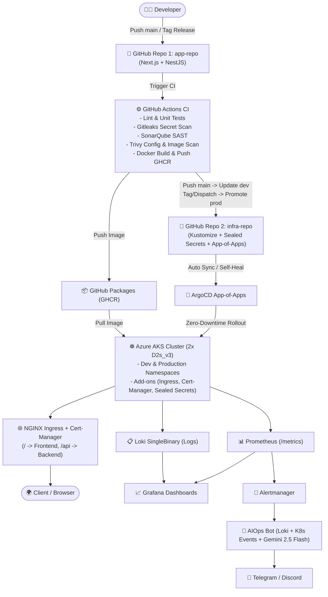

# 🌐 Enterprise DevSecOps & Multi-Environment GitOps Platform

Dự án nền tảng quản trị và vận hành toàn diện: **CI/CD Tự Động Hóa (DevSecOps Shift-Left), Quản Lý Hạ Tầng Đám Mây (IaC), GitOps Đa Môi Trường với ArgoCD App-of-Apps & Sealed Secrets, Giám Sát Observability Tối Ưu Tài Nguyên và AIOps RCA với Google Gemini (`gemini-2.5-flash`).**

---

## 📂 Cấu Trúc Hệ Thống (Git Submodules Architecture)

Dự án được phân chia theo kiến trúc chuẩn doanh nghiệp (Enterprise Separation of Concerns) với 2 repository thành phần độc lập:

| Repository | Loại | Mô tả | Liên kết GitHub |
| :--- | :---: | :--- | :--- |
| **`app-repo`** | Submodule | Mã nguồn ứng dụng Web 3-Tier (**Next.js** standalone Frontend, **NestJS** REST API), Dockerfile multi-stage và GitHub Actions CI/DevSecOps (Unit Test, Gitleaks, SonarQube, Trivy Config & Image Scan, Build & Push GHCR). | [baongdqu/app-repo](https://github.com/baongdqu/app-repo) |
| **`infra-repo`** | Submodule | Repository GitOps trung tâm: Terraform IaC (Azure AKS + bootstrap ArgoCD), Kustomize Overlays (`dev`/`production`), Bitnami Sealed Secrets, ArgoCD App-of-Apps, Observability Stack (`kube-prometheus-stack` + Loki `SingleBinary` + Promtail) và AIOps Bot. | [baongdqu/infra-repo](https://github.com/baongdqu/infra-repo) |
| **`docs/`** | Folder | Chứa tài liệu kế hoạch đồ án chuẩn hóa ([`PROJECT_PLAN.md`](docs/PROJECT_PLAN.md)), phân công nhóm 5 người ([`TEAM_DIVISION.md`](docs/TEAM_DIVISION.md)), bản tóm tắt ([`PROJECT_SUMMARY.txt`](docs/PROJECT_SUMMARY.txt)) và file đăng ký môn học (`NT548.R11_DangKyDoAn.xlsx`). | — |

---

## 🔄 Luồng Tự Động Hóa Khép Kín (End-to-End Pipeline)



---

## 🚀 Hướng Dẫn Clone Toàn Bộ Dự Án (Bao gồm Submodules)

```bash
git clone --recurse-submodules https://github.com/baongdqu/devsecops-project.git
```

Nếu đã clone repo mà chưa tải nội dung 2 thư mục submodule:

```bash
git submodule update --init --recursive
```
