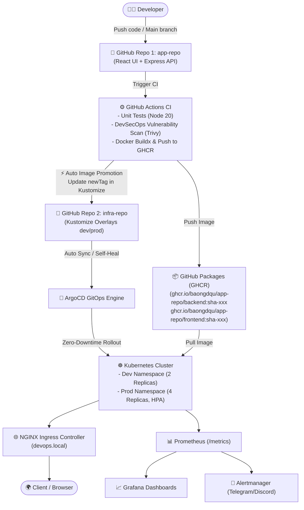

# 🌐 Enterprise DevSecOps & Multi-Environment GitOps Platform

Dự án nền tảng quản trị và vận hành toàn diện: **CI/CD Tự Động Hóa, Quản Lý Hạ Tầng Đám Mây (IaC), GitOps Đa Môi Trường với ArgoCD & Kustomize, Giám Sát Observability và Bộ Kịch Bản Thực Hành Xử Lý Sự Cố Kubernetes.**

---

## 📂 Cấu Trúc Hệ Thống (Git Submodules Architecture)

Dự án được phân chia theo kiến trúc chuẩn doanh nghiệp (Enterprise Separation of Concerns) với 2 repository thành phần độc lập:

| Repository | Loại | Mô tả | Liên kết GitHub |
| :--- | :---: | :--- | :--- |
| **`app-repo`** | Submodule | Mã nguồn ứng dụng Web 3-Tier (React Frontend, Node.js Express REST API), Dockerfile và GitHub Actions CI/DevSecOps (Trivy Scan, Build & Push GHCR). | [baongdqu/app-repo](https://github.com/baongdqu/app-repo) |
| **`infra-repo`** | Submodule | Repository GitOps trung tâm: Cấu hình Kubernetes Manifests (Kustomize Dev/Prod), ArgoCD Applications, Terraform IaC và Observability Stack (Prometheus + Grafana + Alertmanager). | [baongdqu/infra-repo](https://github.com/baongdqu/infra-repo) |
| **`docs/`** | Folder | Chứa toàn bộ tài liệu kế hoạch đồ án, file đăng ký môn học (`NT548.R11_DangKyDoAn.xlsx`) và 9 kịch bản thực hành Kubernetes. | — |

---

## 🔄 Luồng Tự Động Hóa Khép Kín (End-to-End Pipeline)



---

## 📚 9 Kịch Bản Thực Hành Xử Lý Sự Cố Kubernetes (Lab Scenarios)

Hệ thống đi kèm trọn bộ 9 tài liệu kịch bản hướng dẫn chi tiết từng bước kiểm thử và khắc phục sự cố thực tế trong thư mục `docs/`:

1. ⚖️ **[Cân bằng tải 50/50 giữa các Pod](docs/scenario_k8s_can_bang_tai_50_50.md)**: Kiểm chứng phân phối traffic đồng đều qua Service.
2. 🚦 **[Điều hướng Ingress Routing & API](docs/scenario_k8s_dieu_huong_ingress_va_api.md)**: Định tuyến `/` vào Frontend và `/api` vào Backend.
3. 🛑 **[Khống chế tràn RAM 256MB (OOMKilled)](docs/scenario_k8s_khong_che_tran_ram_256mb_oomkilled.md)**: Thiết lập Resource Limits và kiểm thử cơ chế tự bảo vệ hạt nhân.
4. 🏗️ **[Kustomize đa môi trường Dev và Production](docs/scenario_k8s_kustomize_da_moi_truong_dev_prod.md)**: Quản lý cấu hình linh hoạt không trùng lặp (DRY).
5. 👥 **[Duy trì bản sao dự phòng High Availability](docs/scenario_k8s_luon_duy_tri_2_ban_sao_chay_song_song.md)**: Khả năng sẵn sàng cao với ReplicaSet.
6. 🔄 **[Nâng cấp không gián đoạn (Rolling Update)](docs/scenario_k8s_nang_cap_khong_gian_doan_rolling_update.md)**: Cập nhật phiên bản mới 0% downtime.
7. ⚙️ **[Nạp biến môi trường không cần Rebuild Code](docs/scenario_k8s_nap_bien_moi_truong_khong_can_build_code.md)**: Tách biệt cấu hình và mã nguồn qua ConfigMap.
8. 🩺 **[Tự động diệt và dựng lại Pod khi treo](docs/scenario_k8s_tu_dong_diet_va_dung_lai_pod_khi_treo.md)**: Giám sát sức khỏe ứng dụng bằng Liveness Probe.
9. 📈 **[Tự động co giãn lên 5 Pods khi CPU > 70%](docs/scenario_k8s_tu_dong_tang_5_pods_khi_cpu_tren_70.md)**: Tự động mở rộng quy mô linh hoạt với Horizontal Pod Autoscaler (HPA).

---

## 🚀 Hướng Dẫn Clone Toàn Bộ Dự Án (Bao gồm Submodules)

Để clone toàn bộ dự án về máy kèm theo toàn bộ mã nguồn của cả 2 repo con:

```bash
git clone --recurse-submodules https://github.com/baongdqu/devsecops-project.git
```

Nếu đã clone repo mà chưa tải nội dung 2 thư mục submodule:

```bash
git submodule update --init --recursive
```

---

## ⚡ Khởi Chạy Nhanh Ứng Dụng Tại Local

```bash
cd app-repo/app
docker compose up --build -d
```
- **Frontend UI**: [http://localhost:3000](http://localhost:3000)
- **Backend API**: [http://localhost:5000/api/todos](http://localhost:5000/api/todos)
- **Metrics Prometheus**: [http://localhost:5000/metrics](http://localhost:5000/metrics)
