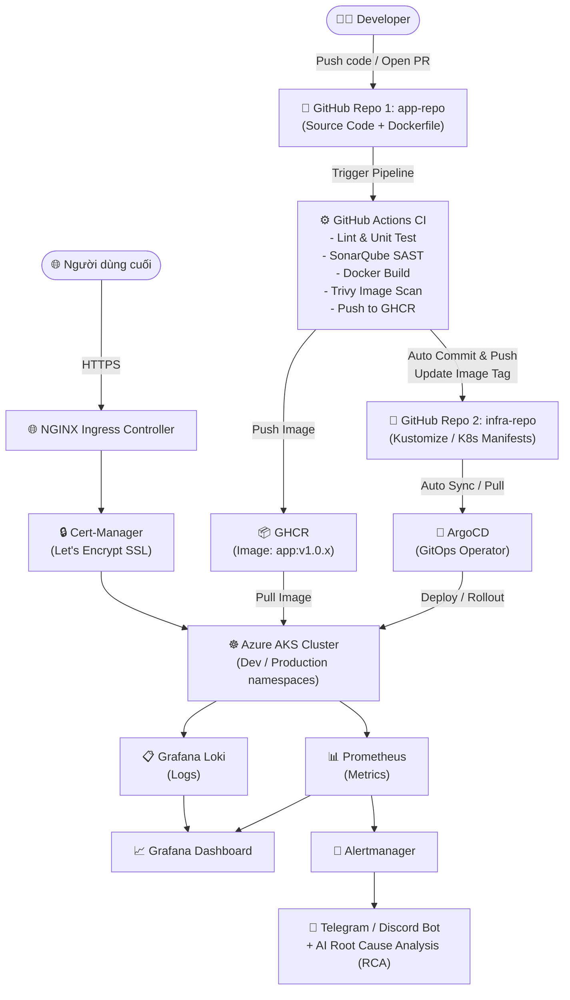

# 🛡️ DevSecOps & Multi-Environment GitOps Project

Dự án đồ án: **Thiết kế và triển khai hệ thống DevSecOps & Multi-Environment GitOps tích hợp AIOps và Observability toàn diện cho ứng dụng Web 3-Tier trên nền tảng Cloud.**

---

## 📂 Cấu Trúc Repositories

Dự án được phân chia theo mô hình **Enterprise GitOps** với 2 repository con được quản lý qua Git Submodules:

| Repository | Loại | Mô tả | Liên kết GitHub |
| :--- | :--- | :--- | :--- |
| **`app-repo`** | Submodule | Mã nguồn ứng dụng Web 3-Tier (React, Node.js REST API), Dockerfile và GitHub Actions CI. | [baongdqu/app-repo](https://github.com/baongdqu/app-repo) |
| **`infra-repo`** | Submodule | Infrastructure as Code (Terraform trên Azure AKS), cấu hình Kustomize (Dev/Prod), ArgoCD manifests và Observability stack. | [baongdqu/infra-repo](https://github.com/baongdqu/infra-repo) |

---

## 🗺️ Kiến Trúc Hệ Thống



---

## 🛠️ Công Nghệ Nòng Cốt

- **Frontend & Backend:** React (Vite), Node.js (Express), PostgreSQL, Redis.
- **Containerization:** Docker, Docker Compose, Multi-stage builds.
- **Infrastructure as Code:** Terraform trên Microsoft Azure (VNet, Subnets, AKS).
- **CI / DevSecOps:** GitHub Actions, SonarQube Cloud (SAST), Trivy (Container Vulnerability Scanning), GitHub Container Registry (GHCR).
- **Continuous Delivery / GitOps:** ArgoCD, Kustomize (Dev & Production environments), Self-healing, Zero-downtime rolling update.
- **Traffic Routing & Security:** NGINX Ingress Controller, Cert-Manager (Let's Encrypt TLS).
- **Observability:** Prometheus, Grafana Loki, Promtail, Grafana Dashboards.
- **AIOps:** Alertmanager Webhook + Gemini API (Phân tích nguyên nhân gốc rễ sự cố tự động) gửi về Telegram / Discord.

---

## 🚀 Cách Clone Dự Án (Bao gồm Submodules)

Để clone toàn bộ dự án cùng 2 submodule `app-repo` và `infra-repo`:

```bash
git clone --recurse-submodules https://github.com/baongdqu/devsecops-project.git
```

Nếu đã clone trước đó mà chưa tải submodules:

```bash
git submodule update --init --recursive
```
