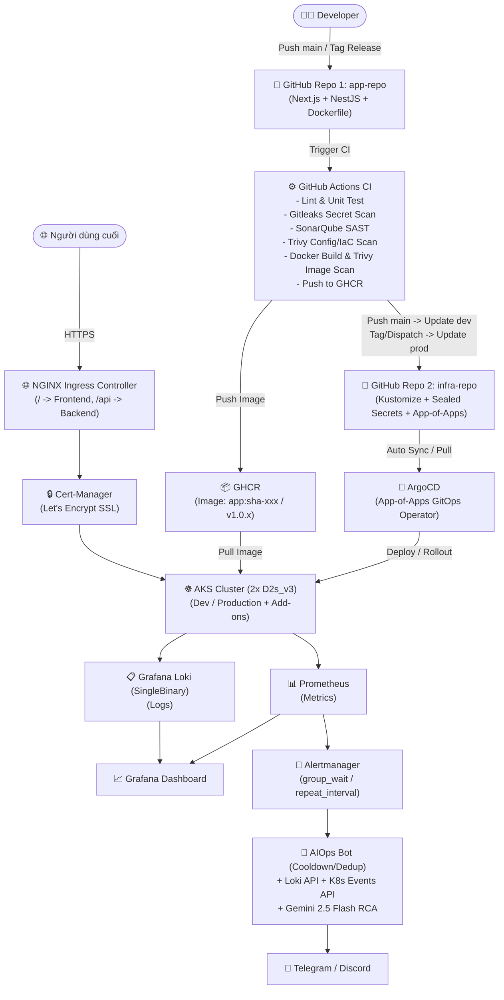

# 📋 Kế Hoạch Chi Tiết Đồ Án: DevSecOps & Multi-Environment GitOps

> **Chủ đề:** Thiết kế và triển khai hệ thống DevSecOps & Multi-Environment GitOps tích hợp AIOps và Observability toàn diện cho ứng dụng Web 3-Tier trên nền tảng Cloud.
>
> *(Bản kế hoạch đã được chuẩn hóa theo 6 điểm tối ưu thực tế; bản gốc được lưu dự phòng tại [PROJECT_PLAN.backup.md](PROJECT_PLAN.backup.md)).*

---

## 🗺️ Kiến Trúc Tổng Quan



---

## 📁 Cấu Trúc 2 Repository

### Repo 1: `app-repo` (Source Code)
```text
app-repo/
├── frontend/                  # Next.js app (output: 'standalone', relative /api)
│   ├── src/
│   ├── Dockerfile
│   └── package.json
├── backend/                   # NestJS REST API (/metrics + health probes)
│   ├── src/
│   ├── Dockerfile
│   └── package.json
├── docker-compose.yml         # Local dev (Next.js + NestJS + Postgres + Redis)
├── sonar-project.properties   # SonarQube config
├── .gitleaks.toml             # Gitleaks secret scan config (nếu cần custom)
└── .github/
    └── workflows/
        ├── ci.yml             # Test -> Gitleaks -> SAST -> Build -> Trivy -> Push -> Update dev
        └── promote-prod.yml   # Release Tag / Manual Dispatch -> Update production
```

### Repo 2: `infra-repo` (Infrastructure & K8s Manifests)
```text
infra-repo/
├── terraform/                 # IaC - Azure AKS + Bootstrap ArgoCD
│   ├── main.tf                # Resource Group, Helm bootstrap ArgoCD + App-of-Apps
│   ├── network.tf             # VNet, Subnets, NSG
│   ├── aks.tf                 # AKS Cluster (2x Standard_D2s_v3)
│   ├── variables.tf
│   └── outputs.tf
├── k8s/
│   ├── base/                  # Kustomize base manifests (Frontend, Backend, Postgres, Redis)
│   │   ├── frontend/
│   │   ├── backend/
│   │   ├── postgres/
│   │   └── redis/
│   └── overlays/
│       ├── dev/               # Dev environment (SealedSecrets + dev config)
│       └── production/        # Production environment (SealedSecrets + prod config + HPA)
├── argocd/
│   ├── root-app.yaml          # ArgoCD App-of-Apps root Application
│   └── apps/                  # Child apps: dev, prod, ingress, cert-manager, sealed-secrets, monitoring, aiops
├── monitoring/                # Helm values tối ưu RAM + PrometheusRules
│   ├── kube-prometheus-stack-values.yaml
│   ├── loki-singlebinary-values.yaml
│   ├── promtail-values.yaml
│   ├── alert-rules.yaml
│   └── grafana-dashboards/
├── aiops-bot/                 # AIOps RCA Bot (Webhook + Loki + K8s Events + Gemini 2.5 Flash)
└── ingress/                   # NGINX Ingress + Cert-Manager ClusterIssuer
```

---

## 🗓️ Kế Hoạch Thực Hiện Theo Giai Đoạn

### **GIAI ĐOẠN 1 — Nền Tảng Ứng Dụng** *(Tuần 1-2)*

**Mục tiêu:** Xây dựng ứng dụng Web 3-Tier (Next.js + NestJS + PostgreSQL + Redis) chạy được local bằng Docker Compose và sẵn sàng promote cùng 1 Docker image qua nhiều môi trường.

| STT | Công việc | Công cụ | Output |
|-----|-----------|---------|--------|
| 1.1 | Tạo ứng dụng Next.js Frontend (bật `output: 'standalone'`, gọi API qua relative path `/api` để không hardcode `NEXT_PUBLIC_API_URL` lúc build) | Next.js | `frontend/` |
| 1.2 | Tạo NestJS REST API (CRUD nghiệp vụ, `/health`, `/ready`, `/metrics` cho Prometheus) | NestJS | `backend/` |
| 1.3 | Cấu hình PostgreSQL + Redis | Docker | `docker-compose.yml` |
| 1.4 | Viết Dockerfile tối ưu (multi-stage build, non-root user) cho Frontend & Backend | Docker | `Dockerfile` mỗi service |
| 1.5 | Kiểm tra toàn bộ stack chạy ổn định với `docker compose up` (kèm reverse proxy/rewrite `/api` ở local) | Docker Compose | Demo local |
| 1.6 | Viết Unit Tests cho Backend API | Jest | Test coverage ≥ 70% |

> [!IMPORTANT]
> **Quy tắc Image Promotion (1 Build, Deploy Anywhere):** Không nhúng URL môi trường cứng vào bundle Frontend lúc `docker build`. Khi lên Kubernetes, NGINX Ingress sẽ route `/` vào Frontend và `/api` vào Backend trên cùng một domain. Nhờ đó, **cùng 1 Docker image** sau khi test ở `dev` có thể promote thẳng lên `production` mà không cần rebuild.

---

### **GIAI ĐOẠN 2 — Infrastructure as Code (IaC) & Auto-Bootstrap** *(Tuần 2-3)*

**Mục tiêu:** Tự động hóa việc khởi tạo hạ tầng Azure AKS bằng Terraform và tự động dựng lại toàn bộ add-ons chỉ với 1 lệnh sau mỗi lần `terraform destroy`.

| STT | Công việc | Công cụ | Output |
|-----|-----------|---------|--------|
| 2.1 | Đăng ký Azure Student / Free Trial, cấu hình Azure CLI | Azure CLI | Azure account active |
| 2.2 | Viết Terraform module: Resource Group, VNet, Subnets, NSG | Terraform | `terraform/network.tf` |
| 2.3 | Viết Terraform module: Azure Kubernetes Service (AKS 2 nodes `Standard_D2s_v3`) | Terraform | `terraform/aks.tf` |
| 2.4 | Cấu hình Terraform Backend (lưu state trên Azure Blob Storage) | Terraform, Azure Blob | Remote state |
| 2.5 | Tích hợp Terraform `helm_release` cài sẵn ArgoCD và apply `argocd/root-app.yaml` (App-of-Apps) | Terraform Helm/Kubectl | Auto-bootstrap cluster |
| 2.6 | Chạy `terraform plan` → `terraform apply` → verify AKS & ArgoCD tự đồng bộ add-ons | Terraform, kubectl | Cluster ready |

> [!TIP]
> Dùng `terraform destroy` sau mỗi buổi làm việc để giữ $100 Azure Student credit. Nhờ tích hợp **ArgoCD App-of-Apps** ngay trong bước bootstrap, mỗi lần `terraform apply` lại, toàn bộ Ingress, Cert-Manager, Sealed Secrets, Monitoring và App sẽ tự động dựng lại không cần cài tay.

---

### **GIAI ĐOẠN 3 — CI Pipeline với DevSecOps & Promotion Flow** *(Tuần 3-4)*

**Mục tiêu:** Xây dựng pipeline GitHub Actions tự động hóa 100%, tích hợp bảo mật Shift-Left đa lớp (Secret + SAST + IaC + Image) và tách biệt luồng promote `dev` → `production`.

#### Sơ đồ Pipeline:
```text
Push to main / PR
        │
        ├──► Job 1: Lint & Unit Test (Jest / ESLint)
        ├──► Job 2: Secret Scan (Gitleaks)
        │
        ▼ (all passed)
┌──────────────────────┐
│  Job 3: SAST         │ → SonarQube Cloud (Quality Gate)
└──────────┬───────────┘
           │ passed
           ▼
┌──────────────────────┐
│  Job 4: IaC/Config   │ → Trivy Config Scan (Dockerfile, k8s/, terraform/)
└──────────┬───────────┘
           │ clean
           ▼
┌──────────────────────┐
│  Job 5: Build & Scan │ → Docker Build (multi-stage) + Trivy Image Scan (CRITICAL/HIGH = fail)
└──────────┬───────────┘
           │ clean
           ▼
┌──────────────────────┐
│  Job 6: Push GHCR    │ → Push image tag sha-xxxxx (chỉ khi push main)
└──────────┬───────────┘
           │
           ▼
┌──────────────────────────────┐
│  Job 7: Update Dev Overlay   │ → Auto commit tag mới vào infra-repo/k8s/overlays/dev/
└──────────────────────────────┘

--- Luồng Promote lên Production (tách riêng) ---
Create Git Tag (v1.x.x) / Workflow Dispatch
           │
           ▼
┌──────────────────────────────┐
│  Promote Prod Workflow       │ → Re-tag image đã kiểm chứng & mở PR / commit vào infra-repo/k8s/overlays/production/
└──────────────────────────────┘
```

| STT | Công việc | Công cụ | Output |
|-----|-----------|---------|--------|
| 3.1 | Tạo workflow `ci.yml` với các bước Test, Gitleaks, SonarQube, Trivy Config, Build, Trivy Image, Push GHCR | GitHub Actions | `.github/workflows/ci.yml` |
| 3.2 | Tích hợp **Gitleaks** quét toàn bộ commit để chống lộ API key/password | Gitleaks | Secret scan gate |
| 3.3 | Cấu hình **SonarQube Cloud** (miễn phí cho public repo) | SonarQube Cloud | Quality Gate dashboard |
| 3.4 | Tích hợp **Trivy** quét cả `Dockerfile` / manifests (`trivy config`) và container image (`trivy image`, fail on CRITICAL/HIGH) | Trivy | Security report |
| 3.5 | Auto-update tag `sha-xxxxx` vào `k8s/overlays/dev/` khi merge vào `main` | GitHub Actions | Automated Dev deploy |
| 3.6 | Tạo workflow `promote-prod.yml` (trigger qua Git Tag `v*` hoặc `workflow_dispatch`) để promote tag lên `k8s/overlays/production/` | GitHub Actions | Controlled Prod release |
| 3.7 | Cấu hình Branch Protection Rules: require CI pass trước khi merge | GitHub | PR gate |

---

### **GIAI ĐOẠN 4 — GitOps CD (ArgoCD App-of-Apps) & Sealed Secrets** *(Tuần 4-5)*

**Mục tiêu:** Triển khai đa môi trường Dev/Production tự động qua ArgoCD, mã hóa an toàn mọi Secrets trên public repo, và tối ưu tài nguyên cho cụm 2 node `D2s_v3` (16 GB RAM tổng).

| STT | Công việc | Công cụ | Output |
|-----|-----------|---------|--------|
| 4.1 | Viết K8s Manifests cơ bản (Deployment, Service, ConfigMap, Probes, `resources.requests/limits` chặt chẽ) | Kubernetes YAML | `k8s/base/` |
| 4.2 | Cài đặt **Bitnami Sealed Secrets** controller và dùng `kubeseal` mã hóa DB password, Redis password, Gemini Key, Telegram Token | Sealed Secrets | `SealedSecret` YAML an toàn trên Git |
| 4.3 | Cấu hình Kustomize overlay cho `dev` namespace (replicas tối thiểu, resource tiết kiệm) | Kustomize | `k8s/overlays/dev/` |
| 4.4 | Cấu hình Kustomize overlay cho `production` namespace (replicas cao hơn, HPA, resource limits chuẩn) | Kustomize | `k8s/overlays/production/` |
| 4.5 | Thiết lập **ArgoCD App-of-Apps** (`argocd/root-app.yaml`) quản lý toàn bộ Add-ons + `dev` (Auto-Sync) + `production` (Auto-Sync hoặc Manual Sync tùy chọn) | ArgoCD | `argocd/` |
| 4.6 | Verify Self-Healing & Rolling Update: xóa pod thủ công / cập nhật tag để demo zero-downtime | ArgoCD, K8s | Demo self-healing & rollout |

> [!NOTE]
> Vì repo là **public** (để dùng SonarQube Cloud & GHCR miễn phí), tuyệt đối không lưu `Secret` dạng plain/base64 trên Git. Mọi thông tin nhạy cảm đều phải bọc qua `SealedSecret`.

---

### **GIAI ĐOẠN 5 — Traffic Routing & Bảo Mật HTTPS** *(Tuần 5)*

**Mục tiêu:** Cấu hình định tuyến hợp nhất (`/` và `/api`) và cấp chứng chỉ HTTPS tự động qua Let's Encrypt.

| STT | Công việc | Công cụ | Output |
|-----|-----------|---------|--------|
| 5.1 | Quản lý NGINX Ingress Controller qua ArgoCD Application | ArgoCD + Helm | LoadBalancer IP |
| 5.2 | Quản lý Cert-Manager qua ArgoCD Application | ArgoCD + Helm | CRDs installed |
| 5.3 | Cấu hình ClusterIssuer Let's Encrypt (staging → production) | Cert-Manager | Issuer ready |
| 5.4 | Tạo Ingress routing: `/` → Frontend service, `/api` → Backend service, kèm annotation TLS | NGINX, Cert-Manager | HTTPS working |
| 5.5 | Map domain (dùng `nip.io` miễn phí theo IP LoadBalancer hoặc domain riêng) | DNS | Domain resolves |
| 5.6 | Verify certificate: `curl -v https://your-domain.com` | curl | Valid TLS cert |

---

### **GIAI ĐOẠN 6 — Observability Stack (Tối Ưu cho 2 Nodes `D2s_v3`)** *(Tuần 6)*

**Mục tiêu:** Triển khai stack giám sát Metrics + Logs gọn nhẹ, không gây `Pending` hoặc `OOMKilled` trên cụm 16 GB RAM.

| STT | Công việc | Công cụ | Output |
|-----|-----------|---------|--------|
| 6.1 | Cài `kube-prometheus-stack` (Prometheus + Alertmanager + Grafana) với `resources` giới hạn và retention `2d` | ArgoCD + Helm | Metrics scraping |
| 6.2 | Expose `/metrics` endpoint trên NestJS Backend API | NestJS, `prom-client` | Custom app metrics |
| 6.3 | Cài **Grafana Loki ở chế độ `SingleBinary`** + Promtail (retention `48h–72h`) để tiết kiệm RAM | ArgoCD + Helm | Centralized logs |
| 6.4 | Tạo Grafana Dashboard: CPU, RAM, Request Rate, Error Rate, Latency | Grafana | Dashboard JSON |
| 6.5 | Tạo Grafana Dashboard: Log Explorer (filter by namespace, service, level) | Grafana + Loki | Log dashboard |
| 6.6 | Viết `PrometheusRule`: alert khi Pod crash (`CrashLoopBackOff`), `OOMKilled`, CPU > 80%, Memory > 90% | PromQL | Alert rules |

> [!WARNING]
> Không chạy Loki ở chế độ Distributed (nhiều microservice) trên cụm 2 node `D2s_v3` vì sẽ ngốn quá nhiều RAM và CPU. Luôn cấu hình `deploymentMode: SingleBinary` và đặt `requests`/`limits` rõ ràng cho Prometheus, Grafana và Loki.

---

### **GIAI ĐOẠN 7 — AIOps: AI-Powered Root Cause Analysis (Loki + K8s Events)** *(Tuần 6-7)*

**Mục tiêu:** Tích hợp AI phân tích nguyên nhân gốc rễ chính xác cả lỗi ứng dụng lẫn lỗi tầng Kubernetes, có chống spam cảnh báo.

#### Luồng AIOps:
```text
Prometheus Alert triggered
        │
        ▼
Alertmanager (group_wait: 30s, repeat_interval: 15m)
        │ (webhook)
        ▼
AIOps Bot Service (Python / Node.js)
        │
        ├── 0. Kiểm tra Cooldown / Deduplication cache (tránh spam & cạn quota)
        │
        ├── 1. Query Loki API → lấy app logs 10 phút gần nhất
        │
        ├── 2. Query Kubernetes API → lấy Pod Status, Termination Reason (OOMKilled...) & K8s Events
        │
        ├── 3. Call Gemini 2.5 Flash API
        │       Prompt: Kết hợp Alert + K8s Events + App Logs → phân tích RCA & cách xử lý
        │
        └── 4. Gửi message đến Telegram / Discord
                Format: 🚨 Alert + ⚙️ K8s Status/Events + 📋 Log snippet + 🤖 AI RCA
```

| STT | Công việc | Công cụ | Output |
|-----|-----------|---------|--------|
| 7.1 | Tạo Telegram Bot / Discord Webhook (lưu token bằng SealedSecret) | Telegram BotFather | Bot token |
| 7.2 | Viết AIOps Webhook Service + cơ chế Cooldown/Deduplication theo `(alertname, pod, namespace)` | Python FastAPI / Node.js | Webhook server |
| 7.3 | Tích hợp **Loki HTTP API** (query app logs) và **Kubernetes API** (`ServiceAccount` read-only lấy Pod status & Events cho các lỗi không có log như `ImagePullBackOff`, `OOMKilled`) | Loki API, K8s Client | Full context fetching |
| 7.4 | Tích hợp **Google Gemini API (`gemini-2.5-flash`)** phân tích RCA có cấu trúc | Gemini API | AI analysis |
| 7.5 | Cấu hình Alertmanager (`group_wait`, `group_interval`, `repeat_interval`) và format message Telegram/Discord | Alertmanager, Telegram API | Smart alert message |
| 7.6 | Deploy Bot Service lên AKS (kèm RBAC `Role`/`ClusterRole` chỉ đọc Pods & Events) | Kubernetes | Bot running in cluster |
| 7.7 | Test end-to-end: giả lập crash app, sai image tag (`ImagePullBackOff`), và vượt RAM (`OOMKilled`) | Full stack | Demo AIOps hoàn chỉnh |

---

### **GIAI ĐOẠN 8 — Kiểm Thử, Tài Liệu & Báo Cáo** *(Tuần 7-8)*

**Mục tiêu:** Hoàn thiện documentation, stress test, quay demo, nộp báo cáo.

| STT | Công việc | Output |
|-----|-----------|--------|
| 8.1 | Viết `README.md` chi tiết cho cả `app-repo` và `infra-repo` | README với hướng dẫn deploy |
| 8.2 | Vẽ diagram kiến trúc chi tiết (draw.io / Excalidraw) | Architecture diagram |
| 8.3 | Ghi video demo toàn bộ luồng từ `git push` → `dev` → `production` → AIOps RCA | Demo video (5-10 phút) |
| 8.4 | Thực hiện bài test stress (k6 / Locust) → xem Grafana & HPA phản ứng | Load test results |
| 8.5 | Viết báo cáo đồ án (PDF) theo cấu trúc: Tổng quan → IaC → CI/CD & DevSecOps → GitOps & Secrets → Observability → AIOps → Kết luận | Báo cáo PDF |
| 8.6 | Chuẩn bị slide thuyết trình | PowerPoint / Slides |

---

## 🛠️ Công Nghệ & Phiên Bản Đề Xuất

| Hạng mục | Công nghệ | Phiên bản / Cấu hình |
|----------|-----------|----------------------|
| **Frontend** | Next.js | 14+ / 15+ (`output: 'standalone'`) |
| **Backend** | NestJS | 10+ (Node 20 LTS) |
| **Database** | PostgreSQL | 15-alpine |
| **Cache** | Redis | 7-alpine |
| **Container** | Docker | Multi-stage build |
| **Orchestration** | Kubernetes (AKS) | 1.29+ (2x `Standard_D2s_v3`) |
| **IaC** | Terraform + Azure Provider | ~> 3.x / 4.x |
| **CI/CD** | GitHub Actions | Latest |
| **Secret Scan** | Gitleaks | Latest |
| **Security SAST** | SonarQube Cloud | Free tier |
| **IaC & Image Scan** | Trivy (`config` + `image`) | Latest |
| **Container Registry** | GHCR | Free |
| **GitOps** | ArgoCD (App-of-Apps) | 2.x |
| **Secrets Management** | Bitnami Sealed Secrets | Latest |
| **Config Management** | Kustomize | Built-in kubectl / ArgoCD |
| **Ingress** | NGINX Ingress Controller | 1.x |
| **TLS** | Cert-Manager + Let's Encrypt | 1.14+ |
| **Metrics** | Prometheus + kube-state-metrics | via `kube-prometheus-stack` (retention 2d) |
| **Logs** | Grafana Loki (`SingleBinary`) + Promtail | 3.x / 2.x (retention 48h–72h) |
| **Visualization** | Grafana | 10.x / 11.x |
| **Alerting** | Alertmanager | via `kube-prometheus-stack` |
| **AI API** | Google Gemini API | `gemini-2.5-flash` |

---

## 💰 Chi Phí Ước Tính

| Dịch vụ | Chi phí | Ghi chú |
|---------|---------|---------|
| Azure AKS (2 node `D2s_v3`) | ~$150-200/tháng | Dùng Azure Student Credit ($100 free), bật khi làm/demo |
| GitHub Actions | **Miễn phí** | Public repo miễn phí hoàn toàn |
| SonarQube Cloud & GHCR | **Miễn phí** | Public repo |
| Gemini API (`gemini-2.5-flash`) | **Miễn phí** | Free tier Google AI Studio |
| Telegram Bot | **Miễn phí** | |
| Domain | ~$0-5/năm | Dùng `nip.io` miễn phí hoặc domain `.xyz` |
| **Tổng** | **~$0-10** | Nếu quản lý `terraform destroy` tốt |

> [!CAUTION]
> **QUAN TRỌNG:** Nhớ chạy `terraform destroy` sau mỗi buổi làm việc để bảo toàn credit Azure. Khi cần dựng lại, chỉ cần `terraform apply` là ArgoCD App-of-Apps sẽ tự đồng bộ lại toàn bộ cluster.

---

## 📊 Timeline Tổng Quan (8 Tuần)

```text
Tuần 1  │████████│ Giai đoạn 1: Ứng dụng Web 3-Tier (Next.js + NestJS) + Docker
Tuần 2  │████████│ Giai đoạn 1 (tiếp) + Giai đoạn 2: Terraform IaC + Bootstrap ArgoCD
Tuần 3  │████████│ Giai đoạn 2 (tiếp) + Giai đoạn 3: CI DevSecOps Pipeline
Tuần 4  │████████│ Giai đoạn 3 (tiếp) + Giai đoạn 4: ArgoCD App-of-Apps & Sealed Secrets
Tuần 5  │████████│ Giai đoạn 4 (tiếp) + Giai đoạn 5: Ingress + TLS
Tuần 6  │████████│ Giai đoạn 6: Observability (SingleBinary) + Giai đoạn 7: AIOps Bot
Tuần 7  │████████│ Giai đoạn 7 (tiếp) + Giai đoạn 8: Stress Test & Docs
Tuần 8  │████████│ Giai đoạn 8: Báo cáo + Video Demo + Nộp bài
```

---

## ✅ Checklist Hoàn Thành

### Kỹ thuật
- [ ] Ứng dụng Web 3-Tier (Next.js standalone + NestJS + Postgres + Redis) chạy ổn định local bằng Docker Compose
- [ ] Terraform tạo được AKS cluster và tự động bootstrap ArgoCD App-of-Apps
- [ ] CI Pipeline: Test → Gitleaks → SAST → Trivy Config → Build → Trivy Image → Push GHCR → Update `dev`
- [ ] Luồng Promote `production` tách biệt qua Git Tag / Manual Dispatch
- [ ] Mọi Secret trên GitHub được mã hóa bằng Bitnami Sealed Secrets
- [ ] ArgoCD App-of-Apps tự động đồng bộ `dev`, `production` và toàn bộ add-ons
- [ ] HTTPS hoạt động với Let's Encrypt certificate (`/` Frontend, `/api` Backend)
- [ ] Prometheus + Loki (`SingleBinary`) + Promtail chạy ổn định trong giới hạn 2 nodes `D2s_v3`
- [ ] AI Bot kết hợp Loki + K8s Events + `gemini-2.5-flash` (có cooldown) phân tích lỗi chính xác lên Telegram/Discord

### Tài liệu
- [ ] `README.md` cho `app-repo` và `infra-repo`
- [ ] Architecture diagram
- [ ] Video demo (≥5 phút)
- [ ] Báo cáo PDF & Slide thuyết trình
