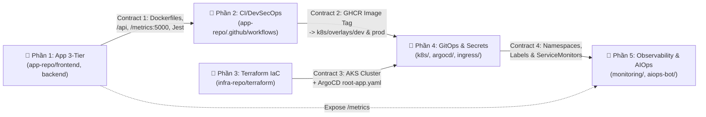

# 👥 Phân Công Nhóm 5 Thành Viên & Interface Contracts

Tài liệu này quy định ranh giới sở hữu thư mục, **Interface Contracts (Hợp đồng giao tiếp)** và quy trình làm việc song song cho **5 thành viên**, đảm bảo làm việc độc lập và **không xung đột Git (Zero Merge Conflict)**.

---

## 🗺️ Sơ Đồ Tách Biệt & Giao Tiếp Giữa 5 Phần

---

## 📊 Bảng Phân Quyền Sở Hữu Thư Mục (Zero-Overlap)

| Thành viên | Nhiệm vụ chính | Thư mục / File sở hữu độc quyền | Nhánh Git đề xuất |
| :--- | :--- | :--- | :--- |
| **Người 1** | Ứng dụng Web 3-Tier & Docker Local | `app-repo/frontend/`, `app-repo/backend/`, `app-repo/docker-compose.yml` | `feat/part1-app` |
| **Người 2** | CI/CD & DevSecOps Pipeline | `app-repo/.github/`, `app-repo/sonar-project.properties`, `app-repo/.gitleaks.toml` | `feat/part2-ci-devsecops` |
| **Người 3** | Cloud IaC (Terraform Azure AKS) | `infra-repo/terraform/` | `feat/part3-terraform` |
| **Người 4** | GitOps, Kustomize, Sealed Secrets & Ingress/TLS | `infra-repo/k8s/`, `infra-repo/argocd/`, `infra-repo/ingress/` | `feat/part4-gitops-ingress` |
| **Người 5** | Observability Stack & AIOps RCA Bot | `infra-repo/monitoring/`, `infra-repo/aiops-bot/` | `feat/part5-observability-aiops` |

> [!IMPORTANT]
> **Quy tắc bất di bất dịch:** Mỗi thành viên chỉ chỉnh sửa file nằm trong thư mục của mình. Nếu cần thay đổi giao tiếp giữa các phần (port, path, label, tên image), phải thống nhất cập nhật **Interface Contracts** bên dưới trước khi sửa code.

---

## 🤝 Chi Tiết Nhiệm Vụ, Test Độc Lập & Interface Contracts

### Phần 1 — Ứng Dụng Web 3-Tier & Đóng Gói Docker
- **Phạm vi:**
  - Next.js Frontend (`output: 'standalone'`, gọi API qua relative path `/api`).
  - NestJS Backend REST API (CRUD nghiệp vụ, auto-migrate + seed DB, `/health`, `/ready`, `/metrics` qua `prom-client`, Unit Test Jest ≥ 70%).
  - Multi-stage `Dockerfile` (non-root user) cho Frontend & Backend + `docker-compose.yml` (Next.js + NestJS + PostgreSQL + Redis + Nginx proxy local).
- **Test độc lập tại local:** `docker compose up --build` và `npm test`.
- **Interface Contract bàn giao:**
  - Ports cố định: Frontend `:3000`, Backend `:5000`, PostgreSQL `:5432`, Redis `:6379`.
  - Endpoints cố định: `/api/*`, `/health`, `/ready`, `/metrics`.
  - Biến môi trường chuẩn (`.env.example`): `DATABASE_URL`, `REDIS_HOST`, `REDIS_PORT`, `PORT`.

---

### Phần 2 — CI/CD & DevSecOps Pipeline
- **Phạm vi:**
  - `ci.yml`: Lint & Unit Test → Gitleaks Secret Scan → SonarQube Cloud SAST → Trivy Config/IaC Scan → Docker Build & Trivy Image Scan (fail on `CRITICAL/HIGH`) → Push GHCR → Auto-update tag ở `infra-repo/k8s/overlays/dev/kustomization.yaml`.
  - `promote-prod.yml` (trigger qua Git Tag `v*` / `workflow_dispatch`) → update tag ở `infra-repo/k8s/overlays/production/kustomization.yaml`.
  - Thiết lập Branch Protection Rules & GitHub Secrets (`PAT_INFRA_REPO`, `SONAR_TOKEN`).
- **Test độc lập:** Chạy workflow thử trên nhánh `feat/part2-ci-devsecops` với `Dockerfile` tối thiểu hoặc tool `act`.
- **Interface Contract bàn giao:**
  - Tên image trên GHCR:
    - `ghcr.io/baongdqu/app-repo/frontend:sha-<short>`
    - `ghcr.io/baongdqu/app-repo/backend:sha-<short>`

---

### Phần 3 — Cloud Infrastructure as Code (Terraform Azure AKS)
- **Phạm vi:**
  - `network.tf`, `aks.tf`, `main.tf`, `variables.tf`, `outputs.tf`: tạo Resource Group, VNet, Subnets, NSG, AKS Cluster (2 nodes `Standard_D2s_v3`).
  - Remote State trên Azure Blob Storage.
  - Terraform `helm_release` cài sẵn ArgoCD + tự động apply `argocd/root-app.yaml` (App-of-Apps).
  - Hướng dẫn/script `terraform apply` & `terraform destroy` tiết kiệm $100 Azure Student credit.
- **Test độc lập:** Chạy `terraform validate`, `terraform plan`, `terraform apply` lên Azure để verify AKS & ArgoCD UI hoạt động.
- **Interface Contract bàn giao:**
  - `kubeconfig` truy cập AKS, Public IP / DNS, và ArgoCD tự động đọc `argocd/apps/` từ `infra-repo`.

---

### Phần 4 — GitOps (ArgoCD App-of-Apps), Kustomize, Sealed Secrets & Ingress/TLS
- **Phạm vi:**
  - K8s Base Manifests (`frontend`, `backend`, `postgres` PVC, `redis`) với Probes & `resources.requests/limits` chặt chẽ cho 2 nodes `D2s_v3`.
  - Kustomize Overlays cho `dev` (`replicas: 1`) và `production` (`replicas: 2`, HPA).
  - Bitnami Sealed Secrets (`kubeseal`) mã hóa DB password, Redis password, Gemini Key, Telegram Token.
  - ArgoCD App-of-Apps (`root-app.yaml` + child apps) & NGINX Ingress (`/` → Frontend, `/api` → Backend) + Cert-Manager (`ClusterIssuer` Let's Encrypt).
- **Test độc lập:** Validate bằng `kubectl kustomize`, `kubeconform` hoặc chạy thử trên `kind` / `minikube` với placeholder image (`nginx:alpine`).
- **Interface Contract bàn giao:**
  - Namespaces chuẩn: `dev`, `production`, `argocd`, `ingress-nginx`, `cert-manager`, `monitoring`, `aiops`.
  - Labels chuẩn: `app: frontend | backend`, `env: dev | production`.

---

### Phần 5 — Observability Stack & AIOps RCA Bot
- **Phạm vi:**
  - Helm values tối ưu RAM cho `kube-prometheus-stack` (Prometheus + Alertmanager + Grafana, retention `2d`) và **Grafana Loki (`SingleBinary`)** + Promtail (retention `48h–72h`).
  - Grafana Dashboards JSON (Metrics + Log Explorer) & `PrometheusRule` (`CrashLoopBackOff`, `OOMKilled`, CPU > 80%, Memory > 90%).
  - **AIOps Bot** (Python FastAPI / Node.js): nhận webhook Alertmanager → Cooldown/Deduplication → query Loki API + Kubernetes API (Pod status & Events) → gọi **Gemini 2.5 Flash** phân tích RCA → gửi Telegram/Discord.
- **Test độc lập:** Chạy stack giám sát + Bot tại local bằng Docker Compose (bắn mock webhook từ Alertmanager vào Bot để kiểm chứng Gemini RCA & Telegram).
- **Interface Contract bàn giao:**
  - Bot webhook URL nội bộ: `http://aiops-bot.aiops.svc.cluster.local:8000/webhook`.
  - Scrape Backend `/metrics` ở port `5000` qua label `app: backend`.

---

## 🔄 Quy Trình Làm Việc Git Nhóm

1. **Cập nhật GitHub Username vào `CODEOWNERS`:**
   - Mở `app-repo/.github/CODEOWNERS` và `infra-repo/.github/CODEOWNERS`, thay `@member1`..`@member5` bằng GitHub username thật của từng thành viên.
2. **Làm việc theo nhánh riêng:**
   - Mỗi thành viên checkout nhánh riêng tương ứng (`feat/part1-app`, `feat/part2-ci-devsecops`, ...) từ `main`.
   - Khi hoàn thành từng hạng mục nhỏ, tạo **Pull Request** vào `main` để kiểm tra không đụng chạm thư mục của người khác trước khi merge.
