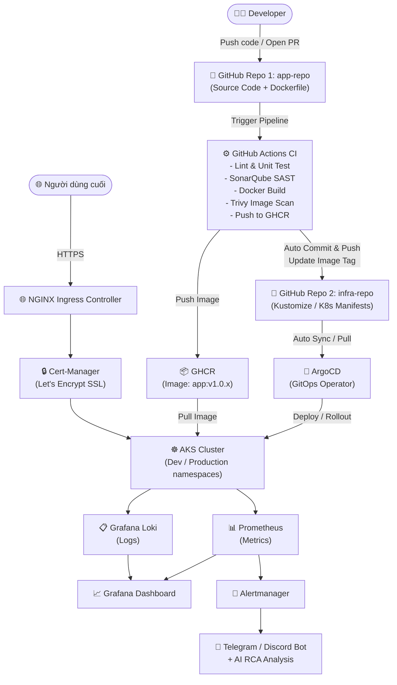

# 📋 Kế Hoạch Chi Tiết Đồ Án: DevSecOps & Multi-Environment GitOps

> **Chủ đề:** Thiết kế và triển khai hệ thống DevSecOps & Multi-Environment GitOps tích hợp AIOps và Observability toàn diện cho ứng dụng Web 3-Tier trên nền tảng Cloud.

---

## 🗺️ Kiến Trúc Tổng Quan



---

## 📁 Cấu Trúc 2 Repository

### Repo 1: `app-repo` (Source Code)
```
app-repo/
├── frontend/                  # Next.js app
│   ├── src/
│   ├── Dockerfile
│   └── package.json
├── backend/                   # NestJS REST API
│   ├── src/
│   ├── Dockerfile
│   └── package.json
├── docker-compose.yml         # Local dev
├── sonar-project.properties   # SonarQube config
└── .github/
    └── workflows/
        └── ci.yml             # GitHub Actions CI pipeline
```

### Repo 2: `infra-repo` (Infrastructure & K8s Manifests)
```
infra-repo/
├── terraform/                 # IaC - Azure AKS
│   ├── main.tf
│   ├── variables.tf
│   └── outputs.tf
├── k8s/
│   ├── base/                  # Kustomize base manifests
│   │   ├── frontend/
│   │   ├── backend/
│   │   ├── postgres/
│   │   └── redis/
│   └── overlays/
│       ├── dev/               # Dev environment
│       └── production/        # Production environment
├── argocd/                    # ArgoCD Application CRDs
├── monitoring/                # Prometheus, Loki, Grafana, Alertmanager
│   ├── prometheus/
│   ├── loki/
│   ├── grafana/
│   └── alertmanager/
└── ingress/                   # NGINX Ingress + Cert-Manager
```

---

## 🗓️ Kế Hoạch Thực Hiện Theo Giai Đoạn

### **GIAI ĐOẠN 1 — Nền Tảng Ứng Dụng** *(Tuần 1-2)*

**Mục tiêu:** Xây dựng ứng dụng Web 3-Tier chạy được local bằng Docker Compose.

| STT | Công việc | Công cụ | Output |
|-----|-----------|---------|--------|
| 1.1 | Tạo ứng dụng Next.js Frontend (giao diện CRUD cơ bản) | Next.js | `frontend/` |
| 1.2 | Tạo NestJS REST API với các endpoint cơ bản | NestJS | `backend/` |
| 1.3 | Cấu hình PostgreSQL + Redis | Docker | `docker-compose.yml` |
| 1.4 | Viết Dockerfile tối ưu (multi-stage build) cho Frontend & Backend | Docker | `Dockerfile` mỗi service |
| 1.5 | Kiểm tra toàn bộ stack chạy ổn định với `docker-compose up` | Docker Compose | Demo local |
| 1.6 | Viết Unit Tests cho Backend API | Jest/Mocha | Test coverage ≥ 70% |

> [!IMPORTANT]
> Ứng dụng phải có ít nhất 1 luồng nghiệp vụ hoàn chỉnh (VD: CRUD sản phẩm, quản lý task...) để pipeline CI/CD có ý nghĩa thực tế.

---

### **GIAI ĐOẠN 2 — Infrastructure as Code (IaC)** *(Tuần 2-3)*

**Mục tiêu:** Tự động hóa việc khởi tạo hạ tầng Azure bằng Terraform.

| STT | Công việc | Công cụ | Output |
|-----|-----------|---------|--------|
| 2.1 | Đăng ký Azure Student / Free Trial, cấu hình Azure CLI | Azure CLI | Azure account active |
| 2.2 | Viết Terraform module: Resource Group, VNet, Subnets, NSG | Terraform | `terraform/network.tf` |
| 2.3 | Viết Terraform module: Azure Kubernetes Service (AKS) cluster | Terraform | `terraform/aks.tf` |
| 2.4 | Cấu hình Terraform Backend (lưu state trên Azure Storage) | Terraform, Azure Blob | Remote state |
| 2.5 | Chạy `terraform plan` → `terraform apply` → verify AKS up | Terraform | AKS cluster running |
| 2.6 | Kết nối `kubectl` vào AKS cluster | kubectl, kubeconfig | Cluster access |

> [!TIP]
> Dùng `terraform destroy` sau mỗi buổi làm việc để tiết kiệm credit Azure. Lưu state file trên Azure Blob để có thể restore lại nhanh chóng.

---

### **GIAI ĐOẠN 3 — CI Pipeline với DevSecOps** *(Tuần 3-4)*

**Mục tiêu:** Xây dựng pipeline GitHub Actions tự động hóa 100%, tích hợp bảo mật Shift-Left.

#### Sơ đồ Pipeline:
```
Push to main / PR
        │
        ▼
┌─────────────────┐
│  Job 1: Test    │  → Lint + Unit Test (Jest/ESLint)
└────────┬────────┘
         │ success
         ▼
┌─────────────────┐
│  Job 2: SAST    │  → SonarQube Cloud (Quality Gate)
└────────┬────────┘
         │ passed
         ▼
┌─────────────────┐
│  Job 3: Build   │  → Docker Build (multi-stage)
└────────┬────────┘
         │
         ▼
┌─────────────────┐
│  Job 4: Scan    │  → Trivy scan image (CRITICAL/HIGH = fail)
└────────┬────────┘
         │ clean
         ▼
┌─────────────────┐
│  Job 5: Push    │  → Push to GHCR (tag: sha + semver)
└────────┬────────┘
         │
         ▼
┌────────────────────────┐
│  Job 6: Update infra   │  → Auto commit image tag mới vào infra-repo
└────────────────────────┘
```

| STT | Công việc | Công cụ | Output |
|-----|-----------|---------|--------|
| 3.1 | Tạo workflow file `ci.yml` với 6 jobs | GitHub Actions | `.github/workflows/ci.yml` |
| 3.2 | Cấu hình SonarQube Cloud (miễn phí cho public repo) | SonarQube Cloud | Quality Gate dashboard |
| 3.3 | Tích hợp Trivy scan image, set fail on CRITICAL/HIGH | Trivy | Security report |
| 3.4 | Push image lên GHCR với tag `sha-xxxxx` và `v1.0.x` | GHCR, Docker | Image on registry |
| 3.5 | Auto-update image tag trong `infra-repo` (via GitHub API hoặc git push) | GitHub Actions | Automated commit |
| 3.6 | Cấu hình Branch Protection Rules: require CI pass trước khi merge | GitHub | PR gate |

---

### **GIAI ĐOẠN 4 — GitOps CD với ArgoCD** *(Tuần 4-5)*

**Mục tiêu:** Triển khai đa môi trường Dev/Production tự động qua ArgoCD.

| STT | Công việc | Công cụ | Output |
|-----|-----------|---------|--------|
| 4.1 | Viết K8s Manifests cơ bản (Deployment, Service, ConfigMap, Secret) | Kubernetes YAML | `k8s/base/` |
| 4.2 | Cấu hình Kustomize overlay cho `dev` namespace | Kustomize | `k8s/overlays/dev/` |
| 4.3 | Cấu hình Kustomize overlay cho `production` namespace (replicas cao hơn, resource limits) | Kustomize | `k8s/overlays/production/` |
| 4.4 | Cài ArgoCD lên AKS cluster | Helm / kubectl | ArgoCD UI accessible |
| 4.5 | Tạo ArgoCD Application CRD cho `dev` environment | ArgoCD | Auto-sync từ infra-repo |
| 4.6 | Tạo ArgoCD Application CRD cho `production` environment | ArgoCD | Manual sync / Auto-sync |
| 4.7 | Verify Self-Healing: thử xóa pod thủ công → ArgoCD tự restore | ArgoCD | Demo self-healing |
| 4.8 | Cấu hình Rolling Update strategy để zero-downtime deploy | K8s | Zero-downtime demo |

> [!NOTE]
> Sử dụng **Kustomize** (native K8s) thay vì Helm để đơn giản hóa, phù hợp với scope đồ án. Helm có thể được dùng cho các third-party tools (ArgoCD, Prometheus...).

---

### **GIAI ĐOẠN 5 — Traffic Routing & Bảo Mật HTTPS** *(Tuần 5)*

**Mục tiêu:** Cấu hình HTTPS với SSL/TLS tự động qua Let's Encrypt.

| STT | Công việc | Công cụ | Output |
|-----|-----------|---------|--------|
| 5.1 | Cài NGINX Ingress Controller lên AKS | Helm | LoadBalancer IP |
| 5.2 | Cài Cert-Manager lên AKS | Helm | CRDs installed |
| 5.3 | Cấu hình ClusterIssuer Let's Encrypt (staging → production) | Cert-Manager | Issuer ready |
| 5.4 | Tạo Ingress resource với annotation TLS | NGINX, Cert-Manager | HTTPS working |
| 5.5 | Map domain (dùng free domain `nip.io` hoặc mua domain rẻ) | DNS | Domain resolves |
| 5.6 | Verify certificate: `curl -v https://your-domain.com` | curl | Valid TLS cert |

---

### **GIAI ĐOẠN 6 — Observability Stack** *(Tuần 6)*

**Mục tiêu:** Triển khai stack giám sát toàn diện Metrics + Logs.

| STT | Công việc | Công cụ | Output |
|-----|-----------|---------|--------|
| 6.1 | Cài Prometheus + Alertmanager bằng `kube-prometheus-stack` Helm chart | Helm, Prometheus | Metrics scraping |
| 6.2 | Expose /metrics endpoint trên Backend API | NestJS, prom-client | Custom app metrics |
| 6.3 | Cài Grafana Loki + Promtail để thu thập logs từ tất cả pods | Helm, Loki | Centralized logs |
| 6.4 | Tạo Grafana Dashboard: CPU, RAM, Request Rate, Error Rate, Latency | Grafana | Dashboard JSON |
| 6.5 | Tạo Grafana Dashboard: Log Explorer (filter by service, level) | Grafana + Loki | Log dashboard |
| 6.6 | Viết PrometheusRules: alert khi Pod crash, CPU > 80%, Memory > 90% | PromQL | Alert rules |

---

### **GIAI ĐOẠN 7 — AIOps: AI-Powered Root Cause Analysis** *(Tuần 6-7)*

**Mục tiêu:** Tích hợp AI để tự động phân tích lỗi và gửi cảnh báo thông minh.

#### Luồng AIOps:
```
Prometheus Alert triggered
        │
        ▼
Alertmanager (webhook)
        │
        ▼
Custom Bot Service (Node.js / Python)
        │
        ├── 1. Query Loki API → lấy logs liên quan (10 phút gần nhất)
        │
        ├── 2. Call OpenAI / Gemini API
        │       Prompt: "Phân tích log sau và đề xuất nguyên nhân + cách sửa:\n{logs}"
        │
        └── 3. Gửi message đến Telegram / Discord
                Format: 🚨 Alert + 📋 Log snippet + 🤖 AI Analysis
```

| STT | Công việc | Công cụ | Output |
|-----|-----------|---------|--------|
| 7.1 | Tạo Telegram Bot / Discord Webhook | Telegram BotFather | Bot token |
| 7.2 | Viết service nhận webhook từ Alertmanager | Node.js / Python Flask | Webhook server |
| 7.3 | Tích hợp Loki API: query log theo label (pod name, namespace) | Loki HTTP API | Log fetching |
| 7.4 | Tích hợp Gemini API (hoặc OpenAI API) cho phân tích RCA | Gemini API | AI analysis |
| 7.5 | Format và gửi message đến Telegram/Discord | Telegram API | Smart alert message |
| 7.6 | Deploy Bot Service lên AKS như một workload riêng | Kubernetes | Bot running in cluster |
| 7.7 | Test end-to-end: crash pod → alert → AI phân tích → Telegram | Full stack | Demo AIOps |

> [!TIP]
> Dùng **Gemini API** (Google AI Studio - miễn phí 60 req/min) thay vì OpenAI để tránh chi phí. Prompt cần được thiết kế cẩn thận để output có cấu trúc rõ ràng.

---

### **GIAI ĐOẠN 8 — Kiểm Thử, Tài Liệu & Báo Cáo** *(Tuần 7-8)*

**Mục tiêu:** Hoàn thiện documentation, quay demo, nộp báo cáo.

| STT | Công việc | Output |
|-----|-----------|--------|
| 8.1 | Viết README.md chi tiết cho cả 2 repo | README với hướng dẫn deploy |
| 8.2 | Vẽ diagram kiến trúc chi tiết (draw.io / Excalidraw) | Architecture diagram |
| 8.3 | Ghi video demo toàn bộ luồng từ git push → production | Demo video (5-10 phút) |
| 8.4 | Thực hiện bài test stress (k6 / Locust) → xem Grafana phản ứng | Load test results |
| 8.5 | Viết báo cáo đồ án (PDF) theo cấu trúc: Tổng quan → IaC → CI/CD → GitOps → Observability → AIOps → Kết luận | Báo cáo PDF |
| 8.6 | Chuẩn bị slide thuyết trình | PowerPoint / Slides |

---

## 🛠️ Công Nghệ & Phiên Bản Đề Xuất

| Hạng mục | Công nghệ | Phiên bản |
|----------|-----------|-----------|
| **Frontend** | Next.js | 14+ / 15+ |
| **Backend** | NestJS | 10+ (Node 20 LTS) |
| **Database** | PostgreSQL | 15-alpine |
| **Cache** | Redis | 7-alpine |
| **Container** | Docker | Latest |
| **Orchestration** | Kubernetes (AKS) | 1.28+ |
| **IaC** | Terraform + Azure Provider | ~> 3.x |
| **CI/CD** | GitHub Actions | Latest |
| **Security SAST** | SonarQube Cloud | Free tier |
| **Image Scan** | Trivy | Latest |
| **Container Registry** | GHCR | Free |
| **GitOps** | ArgoCD | 2.x |
| **Config Management** | Kustomize | Built-in kubectl |
| **Ingress** | NGINX Ingress Controller | 1.x |
| **TLS** | Cert-Manager + Let's Encrypt | 1.13+ |
| **Metrics** | Prometheus + kube-state-metrics | via kube-prometheus-stack |
| **Logs** | Grafana Loki + Promtail | 2.x |
| **Visualization** | Grafana | 10.x |
| **Alerting** | Alertmanager | via kube-prometheus-stack |
| **AI API** | Google Gemini API | gemini-1.5-flash |

---

## 💰 Chi Phí Ước Tính

| Dịch vụ | Chi phí | Ghi chú |
|---------|---------|---------|
| Azure AKS (2 node D2s_v3) | ~$150-200/tháng | Dùng Azure Student Credit ($100 free) hoặc chỉ bật khi làm |
| GitHub Actions | **Miễn phí** | 2000 phút/tháng cho private repo |
| SonarQube Cloud | **Miễn phí** | Public repo |
| GHCR | **Miễn phí** | Public repo |
| Gemini API | **Miễn phí** | 60 req/min free tier |
| Telegram Bot | **Miễn phí** | |
| Domain | ~$1-5/năm | Dùng `.xyz` hoặc `nip.io` miễn phí |
| **Tổng** | **~$0-10** | Nếu quản lý Azure credit tốt |

> [!CAUTION]
> **QUAN TRỌNG:** Nhớ `terraform destroy` sau mỗi buổi làm việc để không bị hao credit Azure. AKS cluster là phần tốn kém nhất (~$5-8/ngày cho 2 nodes).

---

## 📊 Timeline Tổng Quan (8 Tuần)

```
Tuần 1  │████████│ Giai đoạn 1: Ứng dụng Web 3-Tier + Docker
Tuần 2  │████████│ Giai đoạn 1 (tiếp) + Giai đoạn 2: Terraform IaC
Tuần 3  │████████│ Giai đoạn 2 (tiếp) + Giai đoạn 3: CI Pipeline
Tuần 4  │████████│ Giai đoạn 3 (tiếp) + Giai đoạn 4: ArgoCD GitOps
Tuần 5  │████████│ Giai đoạn 4 (tiếp) + Giai đoạn 5: Ingress + TLS
Tuần 6  │████████│ Giai đoạn 6: Observability + Giai đoạn 7: AIOps
Tuần 7  │████████│ Giai đoạn 7 (tiếp) + Giai đoạn 8: Testing & Docs
Tuần 8  │████████│ Giai đoạn 8: Báo cáo + Demo + Nộp bài
```

---

## ✅ Checklist Hoàn Thành

### Kỹ thuật
- [ ] Ứng dụng Web 3-Tier chạy ổn định local bằng Docker Compose
- [ ] Terraform tạo được AKS cluster tự động
- [ ] CI Pipeline: Test → SAST → Build → Scan → Push → Update infra-repo
- [ ] ArgoCD tự động deploy lên Dev khi có image mới
- [ ] ArgoCD deploy Production với approval / auto-sync
- [ ] HTTPS hoạt động với Let's Encrypt certificate
- [ ] Prometheus thu thập metrics từ app và cluster
- [ ] Loki thu thập log tập trung từ tất cả pods
- [ ] Grafana Dashboard hiển thị đầy đủ metrics và logs
- [ ] Alertmanager gửi cảnh báo khi pod crash / resource cao
- [ ] AI Bot phân tích lỗi và gửi message có ý nghĩa lên Telegram/Discord

### Tài liệu
- [ ] README.md cho app-repo
- [ ] README.md cho infra-repo
- [ ] Architecture diagram
- [ ] Video demo (≥5 phút)
- [ ] Báo cáo PDF (≥30 trang)
- [ ] Slide thuyết trình (≥20 slide)

---

## 🚀 Bước Tiếp Theo Ngay Bây Giờ

1. **Tạo 2 GitHub Repository**: `app-repo` và `infra-repo`
2. **Scaffold ứng dụng**: Dùng `create-next-app` cho frontend, `@nestjs/cli` (`nest new`) cho backend
3. **Thiết lập môi trường local**: Docker Desktop, VS Code, kubectl, Terraform CLI
4. **Cài Azure CLI**: Đăng ký tài khoản Azure Student
